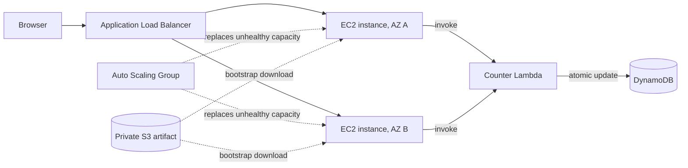

# CloudPulse: AWS High Availability Operations Dashboard

CloudPulse is a portfolio project that demonstrates how to build, monitor, and recover a small web service on AWS. Terraform provisions an Application Load Balancer and an Auto Scaling Group across two Availability Zones. A Python dashboard reports instance telemetry, while Lambda and DynamoDB maintain a shared atomic page-request counter.

> Learning project: The example uses a public HTTP endpoint and public application subnets. Do not use it for sensitive or production workloads without a security and networking review.

## What this project demonstrates

- **High availability:** Load balancing and Auto Scaling across two Availability Zones, with target health checks and rolling instance refreshes.
- **Infrastructure as code:** Reproducible AWS resources and outputs managed with Terraform.
- **Serverless integration:** Python Lambda atomically updates a DynamoDB counter; the web tier invokes it through its instance role.
- **Operational visibility:** Health/readiness routes, instance identity and uptime, JSON application logs, CloudWatch log collection and alarms.
- **Live shared-counter API:** `/api/visits` reads the Lambda/DynamoDB total without incrementing it; the dashboard refreshes this independently from instance telemetry.
- **Troubleshooting and interview prep:** deployment evidence checklist, incident triage guide, and architecture Q&A for technical interviews.
- **Cloud security foundations:** IMDSv2, no inbound SSH, least-purpose service roles, private encrypted S3 artifacts, and ALB-only app ingress.
- **Frontend delivery:** Responsive dashboard with live polling, manual refresh, a remembered light/dark theme, and accessible status announcements.

## Architecture



See [architecture notes](docs/architecture.md) for request flow, design decisions, and current limitations.

For prioritized security, operations, CI/CD, and repository improvements, see the [production-readiness roadmap](docs/production-roadmap.md).

## Application API

| Route | Purpose |
|---|---|
| `/` | Serves the dashboard and increments the global page-request counter once per page load. |
| `/api/status` | Returns responding instance identity, AZ, region, uptime, build version, and local homepage request count. |
| `/api/visits` | Reads the shared counter without incrementing it; the browser refreshes it every 10 seconds. |
| `/health` | Lightweight process liveness check. |
| `/health/ready` | Indicates the web process can serve ALB traffic; the optional counter dependency is not required. |

The local counter is in-memory and resets on server restart. In deployed mode, the Lambda/DynamoDB total is shared across instances. See [interview notes](docs/interview-notes.md) for a short project explanation and design questions.

Use **Refresh now** to request fresh instance telemetry and counter data on demand. The appearance setting is saved in the browser.

## Run locally (Windows PowerShell)

Python 3.10 or newer is required. Local mode uses an in-memory counter and does not need AWS credentials or third-party Python packages.

```powershell
python --version
python app/server.py
```

Open <http://127.0.0.1:8080>. Use `Ctrl+C` to stop. To choose another port:

```powershell
$env:PORT = "8090"
python app/server.py
```

## Run locally (Linux/macOS/WSL)

```bash
python3 --version
python3 app/server.py
```

Open <http://127.0.0.1:8080> and stop with `Ctrl+C`.

## Validate the application

```bash
python3 -m unittest discover -s app -p 'test_*.py' -v
```

On Windows, use `python` in place of `python3`. The suite starts an isolated local server and checks health/readiness, dashboard output, telemetry, static assets, and 404 behavior. After initializing Terraform, validate infrastructure with `terraform -chdir=terraform validate`.

## Deploy to AWS (WSL/Linux)

### Prerequisites

- AWS account with permissions to create the resources defined in `terraform/main.tf`.
- AWS CLI v2 configured with `aws configure` or AWS IAM Identity Center (SSO).
- Terraform 1.5 or later, Python 3, and a region with at least two available Availability Zones.
- Review current AWS pricing before provisioning. ALB and EC2 incur charges while running.

### Plan and deploy

From the repository root:

```bash
export AWS_REGION=us-east-1
export STACK_NAME=cloudpulse-demo
aws sts get-caller-identity
terraform -chdir=terraform init
terraform -chdir=terraform fmt -recursive
terraform -chdir=terraform validate
terraform -chdir=terraform plan \
  -var="aws_region=$AWS_REGION" \
  -var="project_name=$STACK_NAME"
```

Review the plan and verify AWS account and region. Then run:

```bash
./deploy.sh
```

The deployment script applies the stack and prints its URL. Open the URL and check `/health`, `/health/ready`, and `/api/status`. The shell scripts use Bash; run deployment from WSL, Linux, or macOS.

To run the deployed smoke check:

```bash
./scripts/test.sh
```

## Resume-ready description

**Project:** CloudPulse — AWS Highly Available Operations Dashboard  
**Stack:** Python, AWS Lambda, DynamoDB, EC2, Auto Scaling, Application Load Balancer, S3, CloudWatch, Terraform, HTML, CSS, JavaScript

- Designed and provisioned a multi-AZ AWS web service with Terraform, an Application Load Balancer, and an EC2 Auto Scaling Group with ELB health checks and rolling instance refreshes.
- Built a lightweight Python operations dashboard with health/readiness endpoints, live EC2 telemetry, and a read-only shared-counter API that avoids inflating page-request metrics during polling.
- Integrated AWS Lambda and DynamoDB for atomic shared request counting, using EC2 instance roles and private S3-hosted deployment artifacts instead of embedded credentials.
- Added CloudWatch log collection and alarms for unhealthy targets and sustained CPU utilization; documented deployment, recovery validation, and teardown procedures.

Only claim deployment, failover, or monitoring outcomes you personally ran and observed. Add measured results (such as recovery time or instance count) after collecting evidence in your AWS account.

## Demo and evidence checklist

Use [the validation guide](docs/testing.md) to record what you actually observed. A strong portfolio walkthrough shows the dashboard, Terraform plan, healthy targets across AZs, the shared counter in DynamoDB, and recovery after one project-owned instance is replaced.

## Cleanup

In WSL/Linux/macOS, run:

```bash
./cleanup.sh
```

The script displays the AWS identity and requires typing `DESTROY`. Confirm the project name, region, and Terraform state before proceeding. Verify project resources are removed afterward. Keep Terraform state until destroy completes.

## Known limitations and next steps

- The demo serves public HTTP. A production design should use HTTPS and private application subnets, with deliberate egress and secret-management choices.
- The local counter is process-local and resets on restart; only deployed Lambda/DynamoDB mode is shared across instances.
- ALB distributes requests based on its routing algorithm; it does not alternate instances in a fixed order.
- The dashboard reports application-level telemetry, not authoritative AWS control-plane health. The alarm resources have no SNS notification destination.
- Good extensions: HTTPS with ACM and Route 53, private subnets with NAT or VPC endpoints, remote encrypted Terraform state and locking, CI plan/apply gates, SNS notifications, structured metrics/tracing, and load/performance tests.

For common incidents such as ALB 503 responses, unhealthy targets, bootstrap failures, and unavailable counter data, see the troubleshooting section in [interview notes](docs/interview-notes.md).
